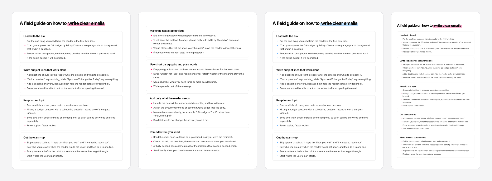
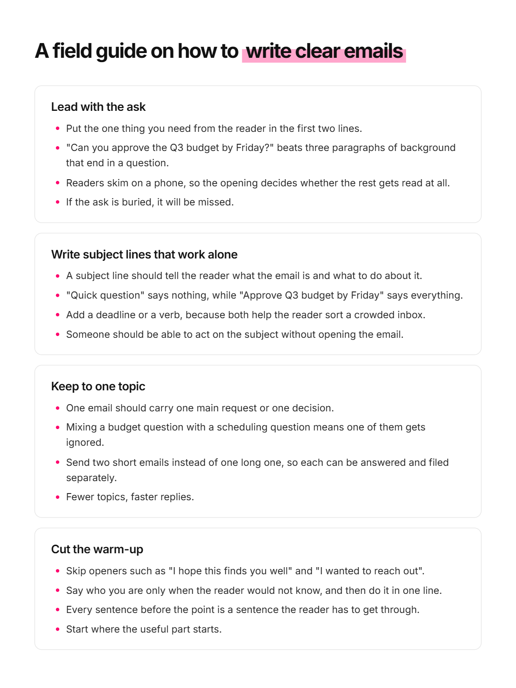
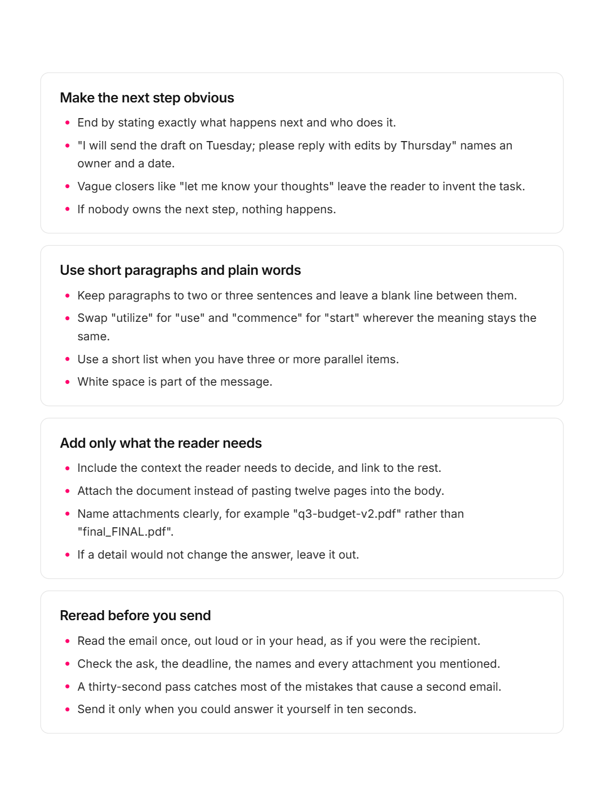
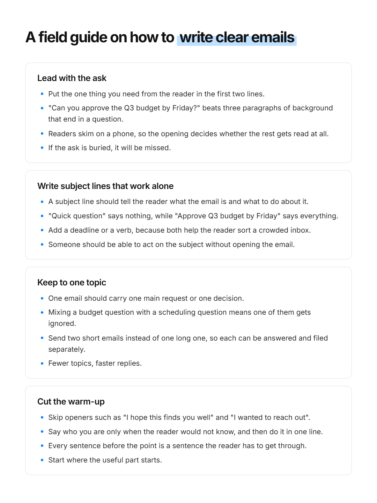

# Forcards skill

The Forcards skill: a reusable [Claude Code](https://claude.com/claude-code) skill that turns notes, transcripts or articles into a stack of
carousel slide PNGs: white canvas, big title with a pink marker, rounded outline cards, pink bullets.



Prefer not to install anything? Paste your markdown into the Forcards website ([source](https://github.com/dremfind-tech/forcards)) and download the PNGs there. This skill itself is distributed through GitHub only.

## Samples

All rendered from [`content/example.md`](content/example.md) with this repo.

| Image | What it shows | Command |
| --- | --- | --- |
| [`samples/default-1.png`](samples/default-1.png), [`default-2.png`](samples/default-2.png) | Default look, 3:4 portrait, 2 slides | `python render.py content/example.md --size ig-tall` |
| [`samples/blue-theme-1.png`](samples/blue-theme-1.png) | Same content with a `theme:` override (blue bullets and marker), source: [`content/example-blue.md`](content/example-blue.md) | `python render.py content/example-blue.md` |
| [`samples/story-1.png`](samples/story-1.png) | 9:16 story size with smaller type, about 5 cards per slide | `python render.py content/example.md --size x-compact` |

<p>
  
  
  
</p>

## Install

Clone this repository into your skills directory so that `SKILL.md` sits at `~/.claude/skills/forcards/SKILL.md`:

```bash
git clone https://github.com/imshreekumarOPS/forcards-skill.git ~/.claude/skills/forcards
python -m pip install -r ~/.claude/skills/forcards/requirements.txt
```

On Windows PowerShell use `$HOME\.claude\skills\forcards`. For a single project, use `.claude/skills/forcards` inside that project instead.

You also need Microsoft Edge or Chrome (used automatically), or run `python -m playwright install chromium`.

## Use

In Claude Code say, for example: *"make a carousel about how to write clear emails"*. Claude researches or uses your notes,
writes `carousel/<slug>.md` in the current folder, renders it, and reports the output folder.

## Use without Claude

```bash
python render.py content/example.md                 # -> content/out/example/slide-01.png ...
python render.py content/example.md --size ig       # 1080x1350 (Instagram 4:5)
python render.py content/example.md --size x        # 1080x1920 (9:16)
python render.py content/example.md --out ./slides  # choose the output folder
```

| `--size` | Pixels | Use |
| --- | --- | --- |
| `ref` (default) | 1920 x 2596 | Reference size |
| `ig` | 1080 x 1350 | Instagram 4:5 |
| `ig-tall` | 1080 x 1440 | 3:4 |
| `x` | 1080 x 1920 | 9:16 |
| `x-compact` | 1080 x 1920 | 9:16, smaller type, about 5 cards per slide |

## Content format

```markdown
---
title: "Subject on how to ==win attention=="   # ==words== get the pink marker
size: ref
theme: {colors: {accent: "#0A84FF"}}            # optional per-post overrides
---

## Card heading
- Claim.
- Evidence.
- Rule.
- Takeaway.

<!-- slide -->        (optional: force a new slide before the next card)
```

Cards are measured in a real browser and packed onto slides automatically; the title appears on slide 1 only.
Copy rules and measurements are in [DESIGN-SPEC.md](DESIGN-SPEC.md).

## Layout

```
SKILL.md                    instructions Claude follows
render.py                   markdown -> PNG slides
formats/listcards/          theme.yaml (all numbers) + template.html.j2
fonts/                      Inter (SIL OFL 1.1, see fonts/NOTICE.md)
content/                    _template.md, example.md, example-blue.md (themed)
samples/                    rendered example images used in this README
DESIGN-SPEC.md              design + copy rules
```
